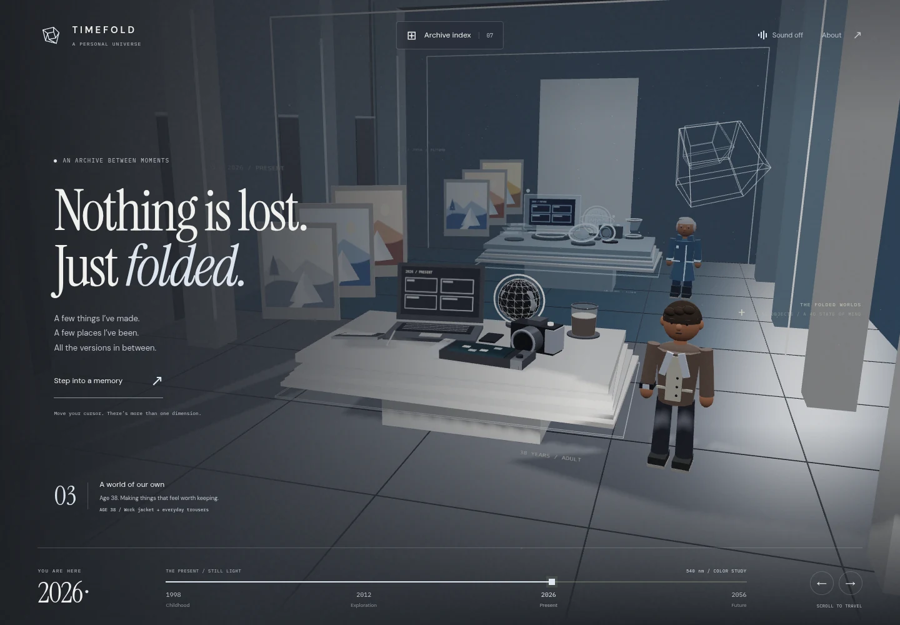
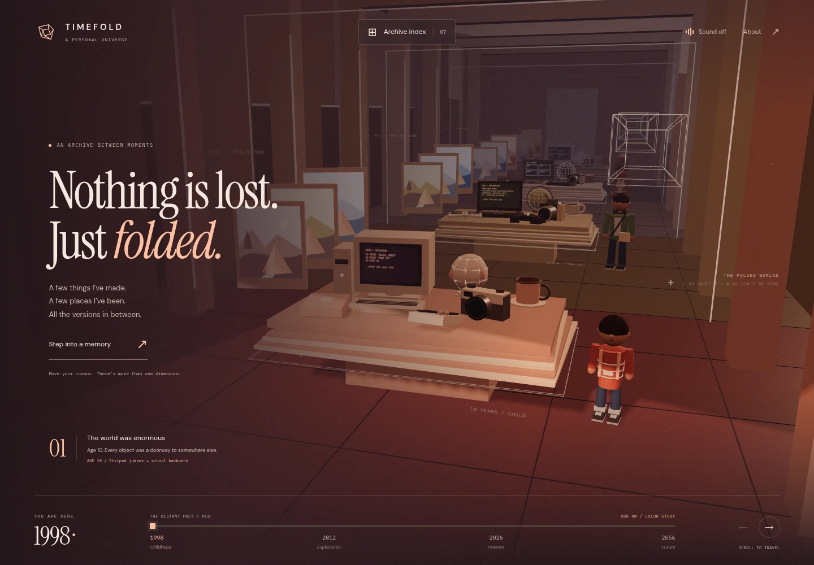
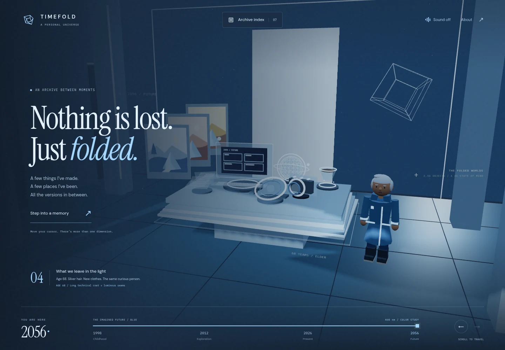

# TIMEFOLD

### An archive between moments.

A WebGL life archive where **time is a place you can explore**. Travel through a liminal corridor, step into miniature worlds, and discover how the same objects—and the person who owns them—change across a lifetime.

**[Get started](#run-locally)** · **[Explore the showcase](#one-room-four-lives)** · **[Make it yours](#make-it-yours)** · **[Read the complete manual](docs/README.md)**



*An actual capture of the running project. All showcase images come from this application; [capture notes](docs/showcase/README.md).*

## One room, four lives

TIMEFOLD combines **The Folded Worlds**, an interactive 2.5D diorama, with a **pseudo-4D timeline** inspired by impossible architecture and the feeling of a place suspended in time.

| 1998 · Childhood                                                                           | 2026 · The present                                                                  | 2056 · An imagined future                                                                        |
| ------------------------------------------------------------------------------------------- | ------------------------------------------------------------------------------------ | ------------------------------------------------------------------------------------------------- |
|  |  |  |
| A family computer, film camera, paper notebook, and a world of firsts.                      | A modern workstation, current tools, and work in progress.                           | Objects made of light and a speculative retrospective.                                            |

Between these chapters, **2012** brings amber light, a first laptop, and the early years of exploration. Scrubbing the timeline blends the atmosphere while each room preserves its own era-specific objects and memories.

| The traveller                                                                                                 | On a smaller screen                                                                         |
| ------------------------------------------------------------------------------------------------------------- | ------------------------------------------------------------------------------------------- |
|                                                                                                               |                                                                                             |
| The same fictional person, from **age 10 to 68**, with changing proportions, hair, clothing, and story. | Touch navigation, a responsive timeline, and an archive index for opening every collection. |

## What you can explore

- **Seven interactive objects:** workstation, camera, game console, notebook, daily ritual, globe, and traveller. Each has a different form and memory in every era.
- **Worlds inside objects:** camera approaches reveal galleries, journal entries, travel fragments, a playable isometric game, and linked projects or posts.
- **A changing atmosphere:** brown, cream, and red become amber, white and grey, then blue and black. The scene and interface share the same evolving palette.
- **Smoother travel:** time-based camera easing, outgoing rooms that fold toward the floor, stable object hover, and rendering that pauses in hidden tabs. Reduced ambient motion also lets settled views rest.
- **An accessible route through the archive:** keyboard controls, labelled dialogs, optional sound, reduced ambient motion, and a content index available when WebGL cannot initialize.

The dates, 1988 birth year, person, artwork, and memories are **fictional sample content**. Future chapters are design fiction. The warm-past/cool-future palette is an artistic metaphor inspired by redshift and blueshift; it is not a physical rule about time. [Read the concept and its references](CONCEPT.md).

## Run locally

Requires **Node.js 20.19+ or 22.12+**, npm, and a browser with WebGL support for the room.

```bash
cd timefold
npm ci
npm run dev
```

Open the URL printed by Vite, usually **http://localhost:5173**. If your terminal is already inside `timefold/`, start with `npm ci`.

```bash
npm run build    # Check TypeScript and create the static site in dist/
npm run preview  # Inspect the production build locally
```

The app uses **TypeScript + Three.js + Vite**, with Canvas 2D for the mini-game and procedural illustrations. Geometry, art, fonts, and ambient audio are local; the bundled experience needs no backend or account. External content links and any remote assets you add use their supplied destinations.

## Controls

| Action                       | Control                                                                                              |
| ---------------------------- | ---------------------------------------------------------------------------------------------------- |
| Travel through time          | Scroll, swipe the scene, or drag the timeline                                                        |
| Jump to a chapter            | Select a year, use the arrow buttons, or press an arrow key                                          |
| Look around                  | Move the pointer for subtle parallax; hover an object to reveal its name                             |
| Open a collection            | Click an object or choose it from **Archive index**                                            |
| Compare an object's history  | Select another year inside its detail panel                                                          |
| Return to the room           | Press **Esc** or use the close button                                                          |
| Play the console's mini-game | Use **WASD**, arrow keys, or on-screen controls; collect three fragments and reach the doorway |
| Adjust the atmosphere        | Enable optional sound in the header; toggle ambient motion in **About**                        |

## Make it yours

1. **Add your work.** Edit `src/archive.ts` to publish projects, posts, games, artwork, links, and progress snapshots. Put local images or game builds in `public/`. Follow the [content authoring guide](docs/CONTENT.md), which includes copyable examples and the exact fields to change.
2. **Shape your timeline.** Change the years, era palettes, object descriptions, age, and outfit data in the same file. Follow the [timeline guide](docs/TIMELINE.md) to keep the room, person, content, and navigation aligned.
3. **Customize the physical world.** Edit the procedural objects, person, and corridor modules when you want different geometry or camera behavior. Start with the [architecture and module connections](docs/architecture/README.md), then use the [source references](docs/reference/README.md).

Content is a set of **manually authored era snapshots**. A URL links to your existing project or article; TIMEFOLD does not automatically import a blog, CMS, or repository. The content guide explains how to preserve a project's earlier states as its progress changes.

## Find your way around the code

| Location                    | What belongs here                                                                                                                                               |
| --------------------------- | --------------------------------------------------------------------------------------------------------------------------------------------------------------- |
| [`src/`](src/)             | Typed archive data and timeline math, a small application controller, grouped `ui/` and `scene/` modules, audio, object/person builders, art, and mini-game |
| [`public/`](public/)       | Files served directly: local fonts, license notices, a sample post, and your future photos, models, or builds                                                   |
| [`docs/`](docs/README.md)  | Build lessons, architecture, authoring guides, module explanations, and generated inventories                                                                   |
| [`scripts/`](scripts/)     | Documentation generation, local-link checking, and dependency-license inventory tooling                                                                         |
| [`CONCEPT.md`](CONCEPT.md) | The combined creative direction, visual language, and limits of the time metaphor                                                                               |

The **[complete documentation manual](docs/README.md)** is designed for learning the implementation as well as maintaining it:

| I want to…                                         | Start here                                                                 |
| --------------------------------------------------- | -------------------------------------------------------------------------- |
| Build an experience like this step by step          | [Learning path](docs/learn/README.md)                                       |
| Follow a click, time change, or rendering update    | [Runtime journey](docs/architecture/runtime.md)                             |
| Understand a particular file or function            | [Module reference library](docs/reference/README.md)                        |
| Find every declaration, callback, and parameter     | [Generated symbol index](docs/generated/SYMBOLS.md)                         |
| Inspect exact era values or stylesheet declarations | [Era data](docs/generated/DATA.md) · [CSS ledger](docs/generated/STYLES.md) |
| Verify changes and keep the manual current          | [Verification guide](docs/learn/09-verification.md)                         |

## Check your changes

After editing source, update its explanatory documentation and regenerate the inventories:

```bash
npm run docs:generate
npm run docs:check
npm run build
```

When dependencies change, also run `npm run docs:licenses` and review the resulting notices. `docs:check` validates local documentation links, reference coverage, and source-inventory freshness. It does not crawl external sites or verify the visual result; use the [verification guide](docs/learn/09-verification.md) for the scene and interaction checks.

## References and reuse

The brief draws on **Interstellar**, liminal/backrooms architecture, **[Rachel Wei&#39;s portfolio](https://rachelqrwei.ca/)**, and **[Blink Industries](https://www.blinkindustries.tv/)**. The implementation uses original procedural scenes and illustrations; no film stills, soundtrack, portfolio screenshots, or external models are bundled. Technical and visual references, including the color metaphor's physics source, are collected in the **[reference register](docs/reference/references.md)**.

See [asset origins](ASSET_SOURCES.md), [third-party notices](THIRD_PARTY_NOTICES.md), and the [rights and reuse guide](docs/rights/README.md) before redistributing or adding outside assets. Three.js and the bundled fonts retain their supplied licenses. **A project-wide source license has not been chosen**; reference links and attribution do not grant permission to reuse someone else's work.
