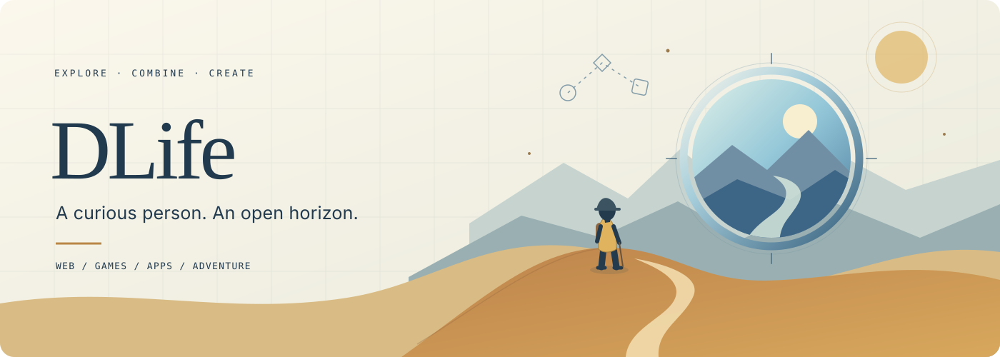

<picture>
  <source media="(max-width: 600px)" srcset="assets/explorer-banner-mobile.svg" />
  <source media="(prefers-color-scheme: dark)" srcset="assets/explorer-banner-dark.svg" />
  
</picture>

<strong>One curious person. A few different worlds.</strong> Web · Games · Apps · Adventure

## Hello, I’m DLife.

I’m a curious person behind an anonymous name. I explore technology and see what happens when ideas from different places meet.

Sometimes that becomes a website you can wander through. Sometimes it’s a game, an app, or an experiment that takes an unexpected turn. Away from the screen, I’m drawn to adventure, unfamiliar places, and a different way of looking at something familiar.

## Things that pull me in

<table>
  <tr>
    <td width="50%" valign="top"><h3>01 / Creative web</h3>
Small worlds, playful interactions, and websites that feel like places.
</td>
    <td width="50%" valign="top"><h3>02 / Games &amp; apps</h3>
Ideas you can play with, use, and keep making a little better.
</td>
  </tr>
  <tr>
    <td width="50%" valign="top"><h3>03 / Unexpected combinations</h3>
A little art, a little code. Two familiar concepts becoming something new.
</td>
    <td width="50%" valign="top"><h3>04 / Adventure</h3>
New paths, small discoveries, and experiences that find their way into what I build.
</td>
  </tr>
</table>

## A world I’ve been building

### [TIMEFOLD — The Folded Worlds](https://github.com/dlifepersona450/DLife/tree/main/timefold)

**A 2.5D diorama + a life archive + time you can navigate.**

Move between eras as the room changes color, familiar objects become older or newer, and the same traveller ages with the story. Open an object to find the memories inside it.

<code>Three.js</code> <code>TypeScript</code> <code>WebGL</code> <code>Creative coding</code>

The first version is built. There’s still room to explore, refine, and learn.

**[Explore the project](https://github.com/dlifepersona450/DLife/tree/main/timefold)** · **[Read the build notes](https://github.com/dlifepersona450/DLife/tree/main/timefold/docs)**

  
<strong>How an idea usually starts</strong>

1. Notice something interesting: a place, a visual, a tool, or a mechanic.
2. Bring it together with an idea from somewhere else.
3. Build a small version and see what it feels like.
4. Keep the interesting parts. Learn from the rest. Try another path.

I like the space between “what if?” and “let’s see.”

---

   
  <strong>Still exploring. Still combining. Still making.</strong> 
  You’ll find me here on <a href="https://github.com/dlifepersona450">GitHub</a>.

