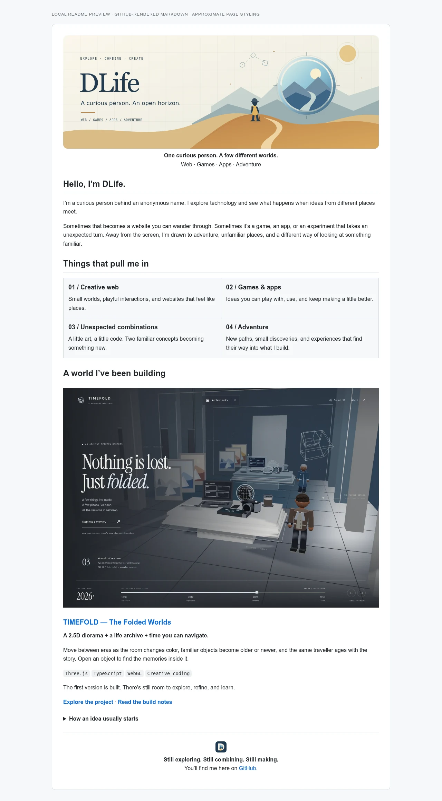
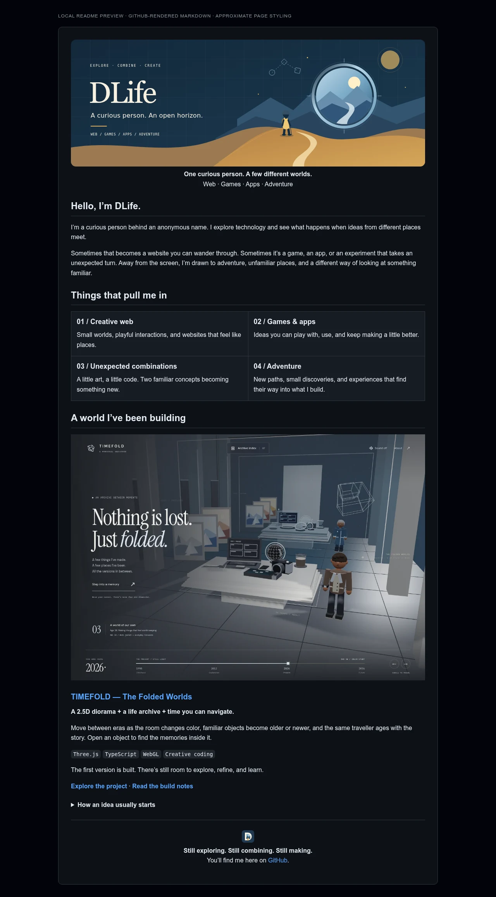
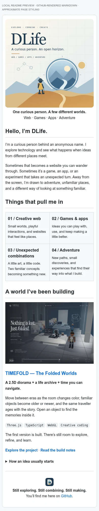

# Maintaining the DLife identity

[Public profile README](../README.md) · [Appearance and settings](APPEARANCE.md) · [Customization](CUSTOMIZE.md) · [Publishing](PUBLISH.md)

**DLife** is an anonymous person exploring technology, creative websites, games, apps, and adventure. The profile presents that curiosity through an original explorer illustration, a matching avatar, and a real TIMEFOLD showcase. It makes no claim about employers, qualifications, follower counts, or external accounts.

Start with [Appearance](APPEARANCE.md) to place the finished assets on GitHub. Use [Customization](CUSTOMIZE.md) when changing words or artwork, and [Publishing](PUBLISH.md) when sending committed changes to the separate profile repository.

## File map

All paths in this table are relative to the profile folder. Publishing makes this folder the root of `dlifepersona450/dlifepersona450`.

| File | Purpose and linkage |
| --- | --- |
| [`README.md`](../README.md) | Public profile composition: responsive banner, introduction, interests, and a linked TIMEFOLD showcase |
| [`assets/explorer-banner.svg`](../assets/explorer-banner.svg) | Original 1400 × 500 light banner and fallback image |
| [`assets/explorer-banner-dark.svg`](../assets/explorer-banner-dark.svg) | Original 1400 × 500 banner selected by the README for a dark color preference |
| [`assets/explorer-banner-mobile.svg`](../assets/explorer-banner-mobile.svg) | Original 700 × 700 composition selected for narrow screens |
| [`assets/explorer-banner.png`](../assets/explorer-banner.png) | Browser export of the light banner for reuse in tools that require raster images |
| [`assets/explorer-banner-dark.png`](../assets/explorer-banner-dark.png) | Browser export of the dark banner |
| [`assets/explorer-banner-mobile.png`](../assets/explorer-banner-mobile.png) | Browser export of the narrow composition |
| [`assets/avatar.svg`](../assets/avatar.svg) | Editable 1024 × 1024 explorer portrait, designed for a circular crop |
| [`assets/avatar.png`](../assets/avatar.png) | Raster export uploaded as the GitHub account picture |
| [`assets/mark.svg`](../assets/mark.svg) | Compact 128 × 128 portal/explorer identity mark for reuse in project graphics |
| [`assets/social-preview.svg`](../assets/social-preview.svg) | Editable 1280 × 640 repository sharing card |
| [`assets/social-preview.png`](../assets/social-preview.png) | Raster export uploaded in each repository's Social preview setting |
| [`assets/timefold-preview.webp`](../assets/timefold-preview.webp) | Actual TIMEFOLD scene capture copied into this folder so the exported profile stays self-contained |
| [`profile.json`](../profile.json) | Single source for the suggested public display name and short account bio; a separate authenticated update applies it |
| [`github-settings.json`](../github-settings.json) | Planning data for avatar, optional status, repository descriptions/topics/visibility, social preview, and pins; nothing reads or applies it automatically |
| [`docs/README.md`](README.md) | This navigation and file map |
| [`docs/APPEARANCE.md`](APPEARANCE.md) | Every asset's GitHub placement, supported profile elements, and the settings JSON field reference |
| [`docs/CUSTOMIZE.md`](CUSTOMIZE.md) | README/SVG structure, asset updates, adding projects, and edit review |
| [`docs/PUBLISH.md`](PUBLISH.md) | Workspace versus profile repository, subtree publication, account updates, and standalone editing |
| [`docs/showcase/README.md`](showcase/README.md) | Preview provenance, dimensions, capture checks, and refresh instructions |
| [`docs/showcase/identity-kit.webp`](showcase/identity-kit.webp) | Local contact sheet of the finished visual assets |
| [`docs/showcase/profile-preview-light.webp`](showcase/profile-preview-light.webp) | Approximate local rendering of the README on a light page |
| [`docs/showcase/profile-preview-dark.webp`](showcase/profile-preview-dark.webp) | Approximate local rendering on a dark page |
| [`docs/showcase/profile-preview-mobile.webp`](showcase/profile-preview-mobile.webp) | Approximate local rendering at a narrow viewport |

The profile itself needs no application dependencies, build step, or server. Markdown supplies content, self-contained SVG supplies vector artwork, PNG supplies upload-compatible versions, WebP supplies screenshots, and JSON stores suggested public metadata. The workspace's optional `scripts/export-profile-assets.mjs` regenerates the five PNGs from their SVG sources using a local browser; its [reference](https://github.com/dlifepersona450/DLife/blob/main/GITHUB.md) lives with the workspace tooling.

## Previews

| Light README preview | Dark README preview | Mobile README preview |
| --- | --- | --- |
|  |  |  |

These are local previews of the prepared files, **not screenshots of a published GitHub profile**. Browser preferences, GitHub's image proxy, sanitization, page width, and theme choices can affect final rendering. After publishing, inspect the actual profile in light and dark modes and at a narrow width.

All artwork and screenshots are local files. There are no visitor counters, external stats cards, badge services, tracking pixels, or third-party typing animations. Normal outbound GitHub links point to the real account and intended project repository.

## Asset origin and rights

The banner variants, avatar, mark, and social card are original static SVG constructed for this persona, with system-font text and custom geometric shapes. Their PNG versions are browser exports of those sources. They contain no downloaded illustration, third-party logo, film still, external font, JavaScript, or linked image dependency.

The TIMEFOLD preview comes from this workspace's procedural WebGL scene; it is evidence of the actual local result. Its copy keeps the image available in the standalone profile repository. The screenshot follows TIMEFOLD's own asset and dependency notices; see its [asset sources](https://github.com/dlifepersona450/DLife/blob/main/timefold/ASSET_SOURCES.md) and [third-party notices](https://github.com/dlifepersona450/DLife/blob/main/timefold/THIRD_PARTY_NOTICES.md). The local preview images and contact sheet show the same prepared materials. Original provenance does not assign a repository-wide license or guarantee that every future imported asset is reusable; record the permission and required credit when adding outside work.

The [appearance reference](APPEARANCE.md#official-references) links the official GitHub documentation used for platform behavior and upload requirements.
