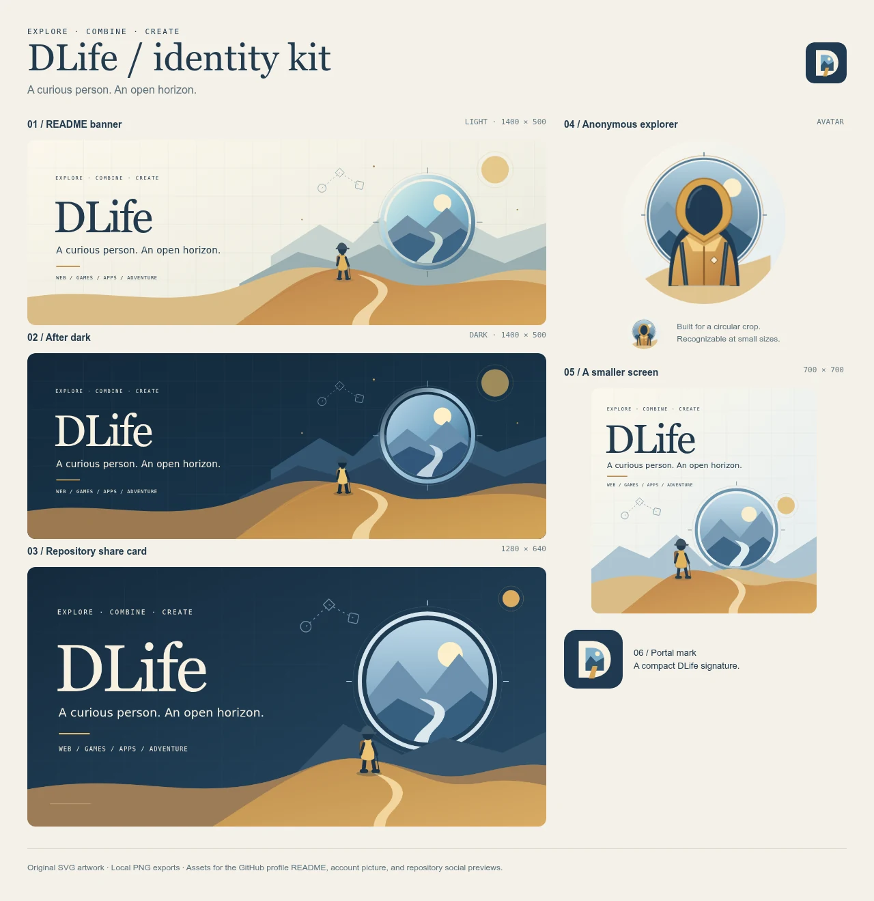

# Identity and README previews

[Persona manual](../README.md) · [Appearance and settings](../APPEARANCE.md) · [Public README](../../README.md)

These are local design previews. The README content was passed through GitHub's public Markdown renderer and then displayed locally with approximate GitHub-style light/dark presentation. They are not screenshots of an already published GitHub account. The rendered markup preserved the `<picture>` sources, interest table, image links, and expandable notes.

| Preview | Contents |
| --- | --- |
| [identity-kit.webp](identity-kit.webp) | 1280×1319 contact sheet of the original banners, circular avatar, repository social preview, and mark |
| [profile-preview-light.webp](profile-preview-light.webp) | 1280×2311 local README preview in light mode |
| [profile-preview-dark.webp](profile-preview-dark.webp) | 1280×2311 local README preview in dark mode |
| [profile-preview-mobile.webp](profile-preview-mobile.webp) | 390×2009 local README preview using the mobile banner |

The previews contain the persona's original SVG artwork, browser-generated PNG exports, and an actual TIMEFOLD screenshot. The TIMEFOLD image is copied unchanged from the first project's documentation into `assets/timefold-preview.webp`, keeping the standalone profile repository self-contained. It is a scene capture, not a deployed-site claim.

## Refreshing previews

1. Update the public README, original SVG assets, and any affected settings documentation.
2. Regenerate uploadable PNGs with the workspace's `scripts/export-profile-assets.mjs` when the SVGs change.
3. Preview the Markdown with GitHub's renderer or a compatible local preview. The stylesheet and page frame can differ between local previews and GitHub; check the published result after uploading.
4. At desktop width, check light and dark modes. At phone width, verify the square mobile banner is selected and no content overflows.
5. Check every image, project destination, and the expandable notes. Capture the whole README with the notes initially closed, then save WebP files using these names.
6. Update the table's dimensions if the content height changes, and commit the refreshed captures together with the source edits.

The banner source order intentionally prioritizes the mobile composition on narrow screens in either theme. On wider screens, the dark source follows the color-scheme preference and the light SVG is the default. PNGs are provided for account/repository uploads; README images remain editable SVGs and the actual project screenshot.
