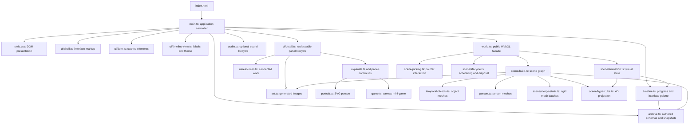

[Docs home](../README.md) · [Learning path](../learn/README.md) · [Symbol index](../generated/SYMBOLS.md)

# Architecture

TIMEFOLD has one application controller and two visual systems. The DOM presents text, controls, dialogs, and linked content. Three.js renders a spatial archive behind it. Both read the same authored era data, but they keep different presentation state: the controller changes the selected chapter immediately; the world can ease its camera and atmosphere toward that target. Small modules give rendering, input, markup, audio, and cleanup explicit owners.

## The module graph

Arrows summarize dependencies rather than every literal import. For example, panel markup and panel controls share a box above, while `scene/settings.ts`, `scene/types.ts`, and `ui/format.ts` support several modules. Some imports are types erased at build time. [Exact import bindings](../generated/IMPORTS.md) enumerate the literal declarations; [runtime flow](runtime.md) covers callbacks and mutable state that an import graph cannot show. The [scene modules](../reference/scene.md) and [UI modules](../reference/ui.md) explain these smaller boundaries in detail.

## Stable identity, changing representations

The stable identity is an `ArchiveId`: `projects`, `photos`, `game`, `journal`, `food`, `places`, or `person`.

For chapter index `i`:

| Representation | Where it comes from |
| --- | --- |
| Category order, icon, mark | `objects` |
| Year, appearance, room colors | `eras[i]` |
| Era-specific object label | `eras[i].objectStates[id]` |
| Featured memory and linked collection | `eraContent[i]` |
| Physical technology silhouette | `createTemporalObject(id, i, ...)` |
| Physical person | `createPerson(eras[i].person, i, accent)` |
| Person-panel portrait | `personPortrait(eras[i].person)` |
| Selectable scene root | `root.userData.id` plus `root.userData.room` |

This identity is the linkage. Changing a category ID requires coordinated changes to the type, authored records, geometry, layouts, and panel dispatch. Adding another project record inside a category does not require another 3D object.

## Four authored rooms, one journey

Each room is at `FIRST_ROOM_Z - i * ROOM_SPACING`. Its scene hierarchy keeps architecture separate from its archive-display group. Floors, walls, and thresholds remain full size. As the visual timeline leaves a chapter, its display smoothly folds toward its floor anchor: `1 - smoothstep(roomTime - room, 0.15, 0.85)` supplies its uniform scale. It becomes hidden at scale zero, before its old props can obstruct the next chapter. Reverse travel unfolds it again. Displays ahead remain to provide depth.

The person and object forms are authored snapshots. They do not biologically morph from one mesh into another. Camera position, lighting, fog, paper-layer bending, and selected-object scale provide continuity. The detailed [world reference](../reference/world.md) explains which variables animate and which remain fixed.

## Three coordinates of progress

1. `timelineProgress` in `main.ts` is the requested normalized input, clamped to `[0, 1]`.
2. `selectedEra` is the nearest authored chapter used by detail content. Its shell labels are painted together by `ui/timeline-view.ts`, once per animation frame or immediately when a dialog opening needs synchronized content.
3. `currentTime` in `scene/animation.ts` is an eased visual position moving toward `targetTime`; reduced motion makes it snap. Picking, focus, and detail content all choose the requested nearest chapter. Other visible rooms remain spatial decoration during the journey, rather than producing a different era's tooltip or content.

Calendar years are interpolated between adjacent chapter years. Chapter spacing is uniform even though calendar gaps are not. At progress `0.5`, the project displays 2019 and age 31. See [time sampling](../reference/timeline.md).

## Interfaces between systems

`createWorld(canvas, onSelect, onHover)` returns a `World` controller with `setTime`, `focus`, `setMotion`, `getDiagnostics`, and `dispose`. It does not know about HTML dialogs. The controller receives scene callbacks and opens the appropriate panel. `world.ts` assembles the builder, animation, picking, and lifecycle modules rather than combining their implementations in one factory.

`createDetailView(container, onSelectEra)` owns replaceable panel markup, local event handlers, and the active mini-game's cleanup. Its `render` method joins an `ArchiveId` and era index to the appropriate markup and controls; `clear` ends that panel's lifetime. Shell elements are cached by `collectInterfaceElements`, while `createTimelineView` owns the changing labels, controls, and CSS palette. See the [UI reference](../reference/ui.md) for the precise contracts and helper functions.

`mountGame(container, options)` owns one canvas, keyboard handler, and local game state. It returns a cleanup function. Re-rendering the detail panel disposes that instance and creates another; it does not preserve game progress.

`personPortrait(person)` returns an SVG string, while `imageData(...)` requests a WebP data URL from Canvas 2D (a browser can fall back to PNG if it cannot encode WebP). They are deliberately different representations. Updating a gallery `src` does not automatically replace a floating WebGL picture frame.

The scene lifecycle schedules frames while ambient motion is enabled or a transition is pending. It stops when a reduced-motion view settles, wakes on explicit changes, and pauses while the document is hidden. Diagnostics expose counters rather than mutable Three.js internals. Read the [performance reference](../reference/performance.md) before interpreting those counters or comparing devices.

## Boundaries

- Content is authored in source, not retrieved from a CMS or database.
- No accounts, server API, persistence, or automatic publication are implemented.
- Outside links open separately; the archive is not an iframe host for every resource.
- WebGL initialization failure leaves the DOM archive index available.
- The only bundled runtime library is Three.js; fonts and their notices are local.

Continue with [every file and directory](files.md), [the runtime sequence](runtime.md), and [contracts, failure cases, and extension boundaries](contracts.md).
