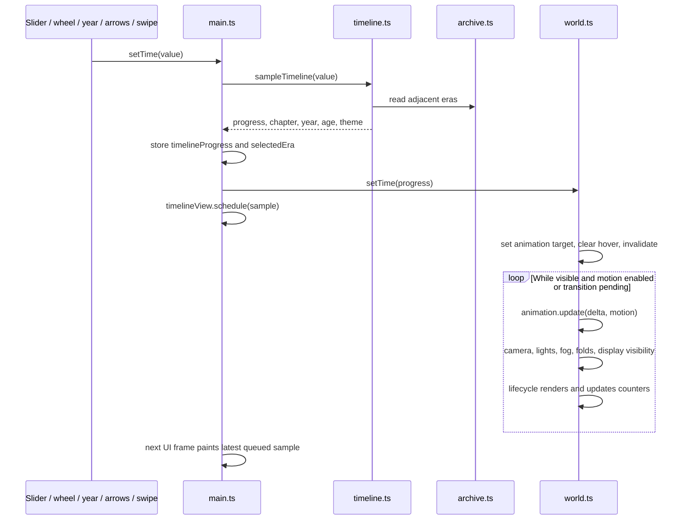

[Docs home](../README.md) · [Architecture](README.md) · [Module references](../reference/README.md)

# Runtime, state, and event linkage

## Startup, in execution order

1. The browser loads `index.html`. Vite resolves `/src/main.ts` as the module entry.
2. Static imports evaluate: CSS is applied, authored data and time helpers are available, and module definitions load. Type-only imports are erased.
3. `renderShell(motionEnabled)` in `ui/shell.ts` produces the header, canvas, intro, timeline, three dialogs, and announcement region. `main.ts` inserts it into `#app`.
4. `collectInterfaceElements` caches the permanent shell elements. The controller creates one timeline view, one detail view, and the optional-audio controller. The detail view prepares gallery/food image URLs once; an authored `src` overrides generated imagery.
5. The controller binds input and dialog handlers with its shared `AbortSignal`. Audio owns its own click/visibility handlers. Replaceable detail controls are bound later, when a panel is rendered.
6. `setTime(0)` samples the starting state; `timelineView.flush()` paints its initial year, age, theme, labels, and controls immediately.
7. Inside a `try`, `createWorld` constructs the renderer, calls `buildScene`, creates the camera, then assembles scene animation, lifecycle, and picking. The lifecycle sizes the viewport and schedules the first frame. The returned `World` facade receives the current time and motion setting.
8. The loading overlay fades and is removed. If creation throws, the controller removes loading, exposes fallback text, and leaves the DOM index usable.

This is a browser module, not a React component tree. There is no virtual DOM, router, hydration, or server-rendered content layer.

## Following a timeline change

Sampling and requested state update immediately. The timeline view coalesces rapid events into one DOM paint per frame, replacing any older queued sample. Chapter-only labels and object names change only when the sampled chapter changes. Opening the index or a detail calls `flush`, so content is synchronized before the dialog appears. With ambient motion enabled, the world can still be temporarily between the old and requested positions. It uses the same theme endpoints, but Three.js color interpolation and CSS byte-channel interpolation are not an identical color-space calculation.

`scene/lifecycle.ts` owns the RAF handle and clamps elapsed seconds. Motion-enabled frames continue while visible; a reduced-motion view stops scheduling frames after its exact camera/time/scale targets settle. Input, focus, resize, and motion changes invalidate that view. Hiding the document cancels its pending frame and resets the clock; returning schedules a fresh frame instead of applying the hidden interval as elapsed travel.

Nearest chapter chooses authored contents. The year/age numbers interpolate continuously between adjacent endpoints. Clicking an object snaps the requested input to the nearest chapter anchor before focusing it, so its detailed content has a definite historical state.

## Following a 3D object click

1. `scene/picking.ts` converts pointer coordinates through the canvas bounding rectangle to normalized device coordinates in `[-1, 1]`.
2. `Raycaster.setFromCamera` constructs a ray from the camera through that point.
3. Candidates come from the requested nearest chapter, pre-indexed in `picksByRoom`, and only a visible display is eligible. This matches the chapter used by focus and DOM content while the camera approaches it. Hover first checks whether its existing root is still intersected, preventing alternating targets along a shared silhouette edge. A click performs a fresh nearest-hit query.
4. The nearest hit's ancestors are followed until one appears in `targetByRoot`, the map of registered selectable roots. Its `PickTarget` record supplies `ArchiveId`. The builder also writes ID/room metadata to those roots for their scene identity.
5. `onHover(id, x, y)` asks the controller to show a tooltip; pointer leave/time/focus clears it.
6. Pointer down stores screen coordinates. Pointer up rejects movement over the click threshold, avoiding a swipe becoming a click.
7. `onSelect(id)` calls `openObject` in `main.ts`. It closes the index if necessary, snaps requested time to `selectedEra`, flushes the timeline view, stores `activeObject`, requests `world.focus(id)`, asks the detail view to render, marks the body as inspecting, and opens the native dialog. The callback carries the category ID, not a separate clicked-room index.
8. The world finds that category's root in the selected room. It converts its position to world space and computes focus-camera/look targets; the person uses a higher target.

The WebGL factory does not directly edit the dialog. The DOM controller does not traverse geometry to decide what a memory says. Their callback boundary keeps the systems understandable.

## Following a panel's year control

Every detail panel has four stage buttons. Selecting one calls the controller's `selectDetailEra(index)`: it samples the era anchor, flushes timeline labels, requests focus on the same `activeObject`, and calls `detailView.render` again. The content, object state, portrait, image collection, and resource snapshots all come from the new era index. Focus returns to the corresponding stage button after replacement.

`createDetailView.render` begins with `clear`: it aborts the prior panel's local listeners and invokes any non-DOM cleanup returned by `mountPanelControls`. For a game this removes its window key handler. It then builds a typed `PanelContext`, renders the registered category panel and resource cards, and binds fresh controls. A new game instance starts fresh; a new gallery starts at its first image. No per-panel state persists across re-rendering.

## Linked content is a separate route

`eraContent[i].resources[id]` is rendered by `ui/resources.ts` as zero or more resource cards. Featured memory fields remain visible above them. A card can show status and progress without a link. `ui/format.ts` provides `safeResourceUrl`, which permits HTTP(S) destinations resolved against the page URL, and `escapeText`, which escapes displayed authored text. The link opens in a new tab with `noopener noreferrer`.

A resource's date is metadata. The array index determines its era, and the array order determines its presentation. Repeating a stable resource ID across eras expresses editorial identity; it does not create an automatic history query or carry records into missing eras.

## Closing and returning

Escape, a close button, or an actual backdrop click closes a dialog. For a detail panel, cleanup removes an embedded game listener, clears the active object, releases world focus, and restores the overview styling. The controller attempts to restore the last valid trigger or falls back to the archive button.

`openIndex` closes a detail before showing the category list. Native `showModal()` supplies modal focus behavior/inert background; the CSS drawer positions the dialog at the right or full-width on small screens.

## Audio and page visibility

`mountAmbientAudio` in `audio.ts` owns the sound button and visibility listener. A click lazily constructs an `AudioContext`, gain nodes, and four sine oscillators inside a guarded operation, then resumes the context, toggles sound, and smoothly changes the master gain. Concurrent toggles are suppressed while a request is pending. Constructor/resume failures produce the unavailable label instead of escaping the click handler. The audio is synthesized locally, with no recording to stream.

Visibility changes suspend an existing context while hidden and resume it when enabled and visible. This audio lifecycle is independent of the scene's visibility pause. Both owners remove their own listeners during disposal. The [interface reference](../reference/interface.md) documents audio's functions, flags, graph, and remaining limits.

## Cleanup boundary

On Vite hot disposal, `main.dispose` aborts every controller listener, clears the loading-removal timeout, cancels queued timeline painting, clears the detail view/game, disposes audio, and disposes the world. It closes remaining dialogs and removes transient body classes.

Audio disposal aborts its button/visibility listeners, stops/disconnects oscillators, disconnects the master gain, and closes the context. World disposal removes all four picking listeners and clears the cursor; lifecycle disposal cancels RAF, removes resize/visibility listeners, and deduplicates attached geometry/material/texture disposal, including the directional-light shadow resources. Game disposal removes its keyboard handler.

The application still has a single module entry rather than an exported router mount API. Its owned resources now have explicit cleanup paths; adding a router should call an equivalent disposal boundary rather than merely replacing `#app`. See [contracts](contracts.md) for allocation and embedding limits.
